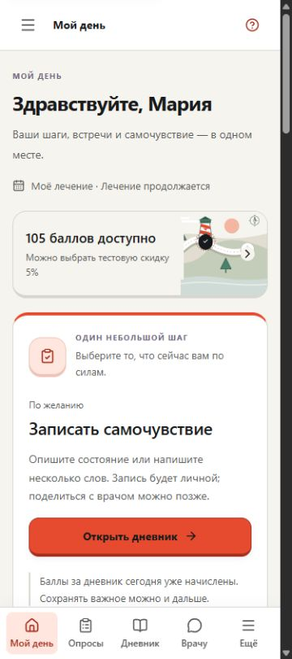
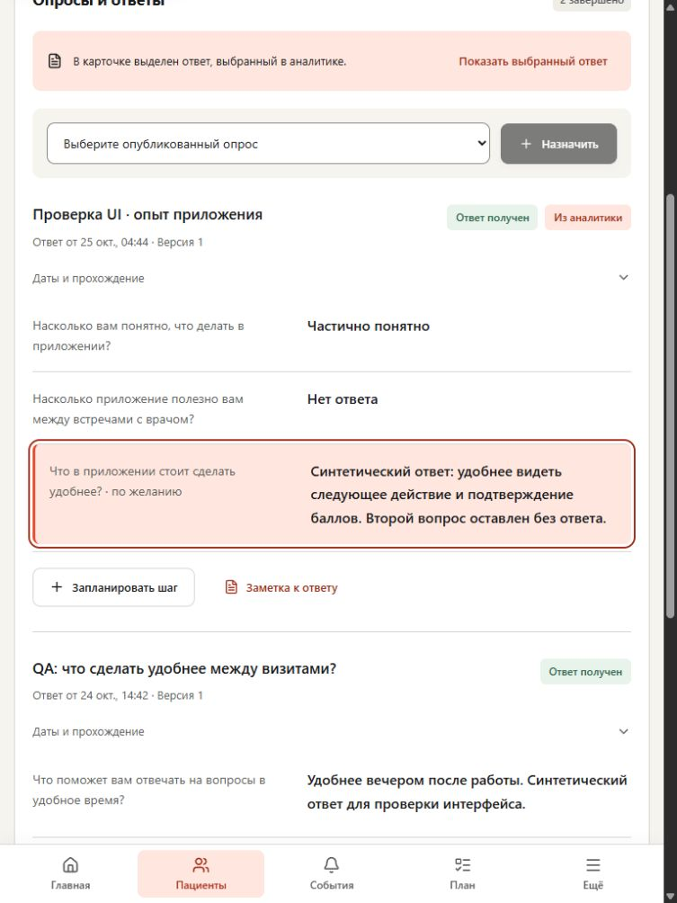
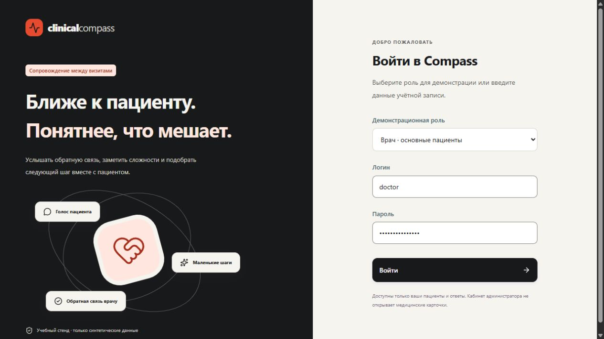

# Проверка интерфейса по видению команды · 25.10.2026

## Иерархия чтения самоотчётов

Заголовок рекомендации12→16px, пояснение врача12→14px/Ink; дата12px отделена от основного текста, отметка пациента12px. [Обе роли на375/768/1440](evidence/self-report-reading-2026-10-25/report.json):6 финальных состояний, безoverflow, действия врача44px. Данные, статусы и их цвета сохранены; рамка на некоторых кадрах — фокус выбранной записи. Только4 CSS-правила;71/151 функциональный срез не повторялся.

## Приватная заметка врача

Ошибка записи остаётся у полей; редактор открывается к ней, текст/категория/источник сохранены. Исправление очищает старую ошибку и удерживает выбранное поле. Сохранённая заметка стала14px, автор/дата12px вместо11/9. [Проверка](evidence/private-note-recovery-2026-10-25/report.json):71 frontend, сборка, native375/768/1440; после явного сохранения врач читает запись, пациент и администратор её текста не видят. В этом UI-проходе не добавлялся серверный ключ идемпотентности заметки.

## Читаемые факты задачи и знаменатель показателя

В узких карточках доски факты размещены в двух колонках:на1280px «Исполнитель» больше не рвётся внутри слова. Все три подписи занимают по одной строке на375/768/1280/1440; полная карточка врача сохраняет прежнюю трёхколоночную компоновку. Подпись аналитики теперь уточняет «33 из всех38 задач», отдельно от37 выполненных и3 с наступившим сроком проверки. [Замеры и снимки](evidence/task-facts-clarity-2026-10-25/report.json):два файла CSS/текста,8 финальных наблюдений безoverflow, сборка/HTTP. Формулы и данные прежние.

## Связанный маршрут четырёх ролей

[Самоотчёт пациента](evidence/self-report-recovery-2026-10-25/report.json) продолжен [врачом, координатором и администратором](evidence/role-care-path-2026-10-25/report.json):источник8unknown→организационнаяtask38→принятие/выполнение→отдельная проверка врачаunknown. В сводке done36→37 при прежнихchecked9, затемchecked9→10/unknown7→8; непроверенные27→28→27. Координатор не видит исходный ответ и врачебное основание, администратор — индивидуальные тексты/карточки.13 нативных наблюдений,9 кадров; код не менялся. Найдены два следующих инженерных улучшения:узкие подписи фактов задачи и явный знаменатель показателя задач без даты проверки.

## Уведомление и нижнее меню

Одна CSS-правка поднимает уведомление над нижней навигацией. [Пять устойчивых состояний трёх ролей](evidence/mobile-notice-clearance-2026-10-25/report.json):у пациента375/768 и врача375 зазор19px; у координатора без нижнего меню остаётся16px снизу, на1440 —24px. Исходный игровой вид и доступность врача возвращены, баланс113. Сборка/HTTP прошли; функциональные69/151 не повторялись. Один десктопный кадр пациента во время выхода уведомления исключён.

## Самоотчёт: ошибка и подтверждение

Ошибка сохранения остаётся рядом с формой и получает фокус; текст и «Не могу оценить» сохраняются. При успехе фокус переходит к конкретной сохранённой записи в истории; открытая во время ожидания помощь его удерживает. Подписи стали13px/Ink, пометка необязательности объединена с вопросом. [Проверка и снимки](evidence/self-report-recovery-2026-10-25/report.json):69 frontend, сборка, native375/768/1280 и4с задержка. На планшете выявлено перекрытие нижнего меню уведомлением — отдельная следующая CSS-задача.

## Читаемые карточки опросов

На телефоне описание было10px, даты/сроки8px; теперь14/12px, заголовки16px/Ink. Поддержка и история получили такую же иерархию; декоративная иконка уступает место тексту на узком экране. Выбор ответа и счётчики используют SignalSoft/SignalDark, приватный черновик — нейтральный Paper; зелёные статусы завершения сохранены. [Измерения до/после и снимки](evidence/survey-visual-consistency-2026-10-25/report.json):7 финальных наблюдений, три ширины, клавиатура, сборка/HTTP. Только два CSS-файла; функциональные66/151 не повторялись.

## Контекст пациентского опроса

При входе с главной активен раздел «Опросы», путь ведёт к списку опросов, помощь объясняет черновик/отправку/просмотр готового ответа. Приветствие больше не отправляет человека обратно на главную. [Diff и проверка](evidence/patient-survey-context-2026-10-25/report.json):66 frontend-проверок, сборка, native375/768/1280. Переход из помощи сохраняет прежнее предупреждение о несохранённых ответах; «Остаться» удерживает текст. Завершённый опрос остаётся только для чтения. Старый URL сохраняется; новых бизнес-правил нет.

## Назначение и приватный черновик

Врач видит полное название/версию выбранного шаблона и ошибку рядом с назначением. Повтор сохраняет ключ запроса; новый выбор требует отдельного нажатия. Ошибки сохранения и отправки у пациента больше не дублируются всплывающим уведомлением. [Полный QA-маршрут трёх ролей](evidence/survey-assignment-flow-2026-10-25/report.json):назначение→пауза→выход/вход→тот же черновик→отправка→квитанция3/баланс113→ответ у врача. До отправки черновик врачу не показан; администратор не видит имя/текст.64 frontend-проверки и сборка прошли. Встроенная помощь формы ещё описывает родительскую главную; это следующий независимый UI-проход.

## Контекст числового ответа

Рядом с сохранённым числом показана исходная шкала, например число «4» и подпись «Шкала от 1 до 5»; дополнительного балла или трактовки нет. Границы берутся из той же версии вопроса. [Пациент, врач и основание действия](evidence/answer-scale-context-2026-10-25/report.json):четыре принятых видимых состояния375/1440px и точный возврат в ответ№4. Ноль остаётся известным ответом, отсутствие — «Нет ответа».60 frontend-проверок и сборка прошли. Медицинские и финансовые решения не менялись.

## Переписка сохраняет место чтения

Ручная прокрутка во время отправки больше не отменяется успешным ответом. Переход вниз выполняется кнопкой «Новые сообщения · Показать»; после её исчезновения фокус остаётся в истории. [Шесть финальных состояний и семь кадров](evidence/chat-reading-position-2026-10-25/report.json):врач1280px и пациент375px, реальные Home/4сdelay/переход в конец, безoverflow.58 frontend-проверок и сборка прошли.

## Переписка: ошибка и возврат к вводу

Пациент и врач видят отказ отправки у формы; текст и отметка поддержки сохраняются, повтор использует прежний ключ. Успех возвращает курсор в поле, сохраняя более поздний выбор другого элемента. [10 наблюдений и кадры](evidence/chat-recovery-2026-10-25/report.json):375/768/1280px, guard «остаться», повтор, правка ошибки,4с ожидания с выбором истории.57 frontend-проверок и сборка прошли. Правила событий и доставки не менялись.

## Понятные версии вопросов в сводке

Техническая запись S6/V1/Q2 убрана из заголовка показателя: теперь рядом отдельная подпись «Опрос6 · Версия1 · Вопрос2» с сохранением разных групп. Общие кнопки действия в заголовках больше не уменьшаются до10–11px/35px на узком экране:13px и минимум44px. [Шесть финальных наблюдений трёх ролей и шесть кадров](evidence/clinic-report-labels-2026-10-25/report.json);375/768/1440px без переполнения. Защита групп, варианты и числа прежние. Проверены54 frontend-сценария, сборка и HTTP/БД.

## Иерархия карточки и восстановление формы

Вложенный заголовок лекарств уменьшен с 28 до 22px и стал h2; имя пациента остаётся единственным h1. Повторяющийся текст сокращён, оговорка об отсутствии самоотчёта сохранена. На личном экране пациента главный h1 прежний. Отказ создания/редактирования теперь показан у полей, получает фокус и связан с формой; новый ввод убирает старую ошибку. [10 наблюдений и 8 кадров](evidence/medication-form-polish-2026-10-25/report.json):375/768/1280px, сохранность ввода, guard «остаться», повтор и квитанция0, баланс110 неизменен. Проверены52 frontend-теста и сборка. Новых медицинских, финансовых или продуктовых решений нет.

## Помощь учитывает открытый экран

Врач уже находился в лекарственной вкладке карточки, но помощь предлагала найти пациента. Теперь заголовок, пояснение и три шага соответствуют каждой из шести вкладок. При закрытии карточки восстановлена обычная помощь списка. [Восемь нативных состояний и пять кадров](evidence/context-help-2026-10-25/report.json):1280×720 и375×844, без переполнения, Escape возвращает фокус в кнопку, Tab/ShiftTab остаются внутри окна. Новых клинических правил нет; изменены только контекст и тексты. Полный frontend49/49 и сборка прошли.

## Последний визуальный проход: обычные действия и фокус

| Проверенный элемент | До | После |
|---|---|---|
| Раскрытие обычных блоков |Старыйteal |Signal Dark из палитры команды |
| Возврат/сброс периода |40px |44px, прежний13px текст |
| Подсказка перед раскрытием |0px до области фокуса |12px, рамка не приближается к строке |

[Наблюдения и4 кадра](evidence/action-style-2026-10-25/report.json). Нативно проверены открытие/Tab/закрытие у врача и пациента375px, видимый3px focus, период44px, совпадение двух зелёных статусов до/после. Расчёт по computed solid colors:Signal Dark/Paper6,35:1,Signal Dark/White6,98:1. Это два конкретных контраста, не общая WCAG-приёмка. Изменены3CSS-файла, TypeScript/Vite иHTTProot/20assets/обеБД PASS. JS/семантика/данные не менялись; последний функциональный48/48 не повторялся ради CSS. Новых вопросов/клинических правил нет.

## Последний проход: переход не ждёт анимацию

Общий дефект быстрого входа исправлен: корневая страница сразу монтируется по выбранному адресу, прежняя удаляется после разрешённого перехода. Мягкое появление200мс берёт значения из существующих motionTokens через CSS-переменные и отключается при reduced motion. История/guard/фокус не менялись; анимации уведомлений и внутренних блоков сохранены.

[Доказательства](evidence/route-frame-2026-10-25/report.json):actualWorkspace с полностью удержанным RAF сначала не показывал выбранный дневник, после исправления показывает сразу; guard по-прежнему требует решения о черновике и удаляет старую форму только после согласия. Полный frontend48/48 за42766,2719мс, TypeScript/Vite PASS. Native15 принятых состояний: повторный быстрый вход пациента/врача/администратора, серия переходов, координатор,375/768/1440px, мобильный guard и точная цитата→ответ→Back с восстановлением19 раскрытых ответов/фокуса. Во всех один текущий root, правильный h1/адрес, без горизонтального переполнения. Последние40warn/error пусты.

Два CUA-экспорта axe/JSDOM:0violations/6incomplete. HTTPmain root/20assets/обеБД ok, entry387672байта(−22,4%). Backend не менялся. Промежуточный кадр при resize исключён и переснят; первые opacity-замеры ещё попадают в конец CSS-появления, это не FPS/SLA-замер. Полные browser/WCAG/диктор/pixel-baseline/WebVitals/max500 остаются открытыми.

## Последний проход: короткий дневник

| На375×844 | До | После |
|---|---|---|
| Начало поля записи |819px, после4 дополнительных полей |328px, первый элемент формы |
| Кнопка сохранения |1133px |696–740px, выше нижнего меню777px |
| Подтверждение после сохранения |Низ795px, частично перекрыт меню |Низ754px, видно целиком |

Существующие чувства/влияние/время/тип записи помещены в анимированное раскрытие, значения сохраняются при сворачивании. Приватность видна рядом с текстом и по умолчанию выключен доступ врачу. Валидация обязательного времени раскрывает поле и возвращает фокус; клавиатура пропускает скрытые поля.503 даёт один локальный alert с сохранением текста; повтор использует прежний ключ. Проверены запись без текста с наблюдениями, guard с возвратом фокуса и осознанный уход без записи.

[Отчёт и10 кадров](evidence/diary-flow-2026-10-25/report.json):RED1pass/4fail →5pass; полный frontend47/47 за38463,3809мс, TypeScript/Vite PASS. Native375/768/1440, баланс QA110 не вырос после двух новых записей с нулевой дневной квитанцией. Две CUA-разметки axe/JSDOM:0violations/6incomplete. Backend/поля/права/начисления не менялись; прежние151 тест относятся к предыдущему серверному срезу. HTTP8780 root/20assets/обеБД ok.

Во время проверки отдельно воспроизведён быстрый переход после входа: меню/заголовок уже «Дневник», а старый frame «Мой день» остаётся inert/opacity0. Этот дефект закрыт следующим [проходом переходов](evidence/route-frame-2026-10-25/report.json); исходный снимок сохранён. Первый CUA fill даты не обновлял React-state; финальное подтверждение валидации сделано реальными Control+A/Backspace и не подменяет этот промежуточный замер.

## Последний проход: лекарственное расписание и понятная мотивация

Создание/исправление личной позиции и лекарственного самоотчёта возвращают фактическую квитанцию участия. Она переживает обновление расписания, различает положительное/нулевое/неизвестное начисление и повтор, ведёт в «Мой прогресс». Новый несохранённый ввод скрывает старое «Сохранено». При503 ответ и комментарий остаются в форме; фокус получает одно локальное сообщение ошибки, связанное с группой полей. История показывает доступное название позиции вместо `local:…`. Убрана вложенность p/p в пустом расписании.

[Отчёт](evidence/medication-receipts-2026-10-25/report.json):151/151 backend за86,07с;42/42 frontend за31960,5659мс; TypeScript/Vite PASS. Нативно проверены все четыре операции POST/PUT позиции и POST/PATCH отчёта, ошибка/повтор, пять полных компоновок подтверждения375/768/1440px, обновлённый баланс и врачебное чтение без редактирования. Учебная позиция архивирована. Только QA-баланс105→107→110:2 за лекарства,3 за личный дневник; основной демо-набор не менялся. Врачебный дневник действительно пуст при личной записи пациента.

Получение квитанции включено до commit; четыре инъекции ошибки проверяют отмену изменения, начисления и аудита вместе. Ставки/дневной лимит, права и МИС не менялись, миграций нет. Новые поля ответа добавлены совместимо; локальный API перезапущен, root/20assets/обеБД ok. Три CUA-разметки в axe/JSDOM:0violations/9incomplete; это не browser/WCAG pass. Промежуточные503/первый вариант и кадр после resize с сохранённой прокруткой отдельно ограничены в отчёте.

Найдены следующие самостоятельные проблемы дневника: на375px перед текстом четыре дополнительных поля; textarea начинается на819px, кнопка сохранения —1133px. После сохранения низ подтверждения частично закрывает нижнее меню. Это зафиксированный следующий проход, не завершённое исправление.

## Последний проход: текущий раздел остаётся видимым

Подтверждён переход «Мой день → Выбрать тестовую скидку»: раньше выбранный «Мой прогресс» находился ниже видимой части меню. Теперь прокручивается только nav, основная страница остаётся у начала с фокусом main. На коротком экране ссылки больше не сжимаются: подписи сохраняют10px нижнего отступа внутри выбранного фона.

[Отчёт и8 кадров](evidence/navigation-visibility-2026-10-25/report.json):13 принятых наблюдений видимости на375/768/1280/1440px и высоте700px,27 проверенных пунктов четырёх ролей. Намеренное перемещение клавиатурой к другой ссылке имеет приоритет; Escape возвращает фокус на открытие меню. Врачебная цитата → точный ответ → Browser Back возвращает фокус к `analytics-quote-1-details`, список19 ответов остаётся раскрытым. Промежуточный снимок до CSS-исправления и закрытое меню не считаются финальной приёмкой. Последние40warn/error пусты.

38/38 frontend за26114,1844мс, TypeScript/Vite PASS; после CSS-only правки повторены сборка и нативные замеры. HTTP8780 root/20assets/обеБД ok. Новых клинических/серверных правил нет. Полные browser/WCAG, диктор, эталон визуальной регрессии и измерения плавности остаются открытыми.

[Материал команды и принятые решения](TEAM_VISION_2026-10-25.md) применены в работающем интерфейсе. Приложение доступно на <http://127.0.0.1:8780/>. Изменения пока локальные.

## Что изменилось

Последний проход границ сессии: отложенный401 старого запроса не завершает новый вход, но сам запрос остаётся отклонённым.401 текущей сессии по-прежнему вызывает выход;403 остаётся отказом в доступе. Уведомления привязаны к исходному ID/роли: завершение старой заметки не сообщает новому врачу, что его действие сохранено. Корректное уведомление текущего пациента проверено нативно, режим восстановлен map/105 баллов. Вход пациента, администратора, координатора и врача проходит; у администратора не появились ссылки на персональные карточки.

[Отчёт и3 кадра обычного входа](evidence/session-boundaries-2026-10-25/report.json): два корректно воспроизведённых сбоя в API/настоящем Workspace с подставным транспортом, затем4/4 целевых и38/38 общих тестов за25,77с. Это не нативная инъекция истёкшего JWT и не новая серверная проверка прав. Сборка/типы и HTTP20 assets/двух БД проходят, консоль последних40warn/error пуста. Изменены только два клиентских обработчика; клинические правила, серверные права и формат запросов сохранены. Полные a11y/визуальная регрессия/плавность и max500 остаются открытыми. Ниже — предыдущие срезы.

Последний проход доступности врача: единственное поле перенесено к профилю, на телефоне оно доступно в меню. Размер 190×45 px на375/768, 204×44 px на desktop; профиль целиком виден и на1280×720. Сохранение явно показано, поле временно заблокировано;503 показывает связанное с полем сообщение внутри меню и возвращает фокус. Tab/Shift+Tab остаются в меню, Escape возвращает к кнопке открытия. После переноса общего механизма фокуса пациентский выбор map→rhythm→map повторно проверен,105 баллов сохранены.

Воспроизведена отдельная ошибка: ответ PATCH первого врача после выхода применялся к локальному статусу второго вошедшего врача. Теперь результат привязан к автору изменения. Проверены исходная ошибка и исправленный сценарий с4с задержкой; повторный вход подтвердил, что сервер изменил именно первого врача. Оба тестовых статуса восстановлены. Это узкая защита ответа доступности, не заявление о полной защите всех асинхронных действий приложения.

[17 наблюдений и8 кадров](evidence/doctor-availability-2026-10-25/report.json),34/34 frontend за21,49с, TypeScript/Vite, HTTP20 assets/обеБД. Добавлена проверка настоящего Workspace с отложенным ответом и сменой аккаунта; фикстура не выполняет клинических записей. Новая axe/JSDOM-выгрузка0violations/3incomplete. Навигационная прокрутка получила тёмный трек, метацвет браузера — Paper. В отчёте отдельно отмечены исключённый замер закрытого меню после resize и промежуточная ширина89px, исправленная до190px. Полные a11y/диктор/визуальный эталон/FPS/WebVitals и max500мс остаются открытыми. Ниже — предыдущие срезы.

Последний врачебный проход: «Голос пациента» теперь показывает название исходного опроса и позволяет раскрыть остальные полученные ответы. В QA доступны 19, первоначально видны 5; раскрытие добавляет 14 после кнопки, не перескакивая к концу списка. На 375 px нативный Enter сохранил положение кнопки400,02px и фокус. Ответ о стоимости/графике открывает точный вопрос Ивана Петрова; обычный возврат на375/1440 и Back на768 вернули к `analytics-quote-1-details` с раскрытыми19 ответами. На телефоне кнопка возврата к цитате расположена392,55–436,55px при нижнем меню777px. Источники, поля и графики не переполняются на трёх размерах; новые подписи не классифицируют опыт приложения как клиническое измерение. Проценты в воронке/охвате теперь также используют русскую запятую.

[Отчёт и 9 кадров](evidence/doctor-feedback-2026-10-25/report.json): 33/33 frontend за17,30с, TypeScript/Vite, HTTP20 ресурсов/обе БД; новая компонентная регрессия сначала воспроизвела отсутствующий переход, затем прошла точные ID/возврат состояния. Две разметки axe/JSDOM:0 обнаруженных нарушений,6 incomplete сохранены. Существующее ограничение API до20 последних свободных ответов явно показано; вся история/категорийный drill-down не объявляются реализованными. Backend, права и медицинские правила не менялись. Ниже — предыдущие срезы пациента и остальных ролей.

Последующий проход самой карты: прежнее касание видимой отметки не меняло выбор — кнопки находились ниже. Теперь на рисунке пять настоящих HTML-кнопок, без дублирующего списка. На 375 px пояснение стало ближе на 554,55 px; явный выбор показывает его целиком над нижним меню и сохраняет фокус кнопки. Нативные касания первого/будущего места и Shift+Tab/Enter проверены; текущий Маяк и баланс 105 не меняются от выбора. В четырёх ширинах 320/375/768/1440 нет переполнения или перекрытия целей; минимальная цель 44 px. На 320 px вся сцена не помещается над меню, доступна обычная прокрутка. Превью главной остаётся декоративным, без вложенных кнопок.

[Новый отчёт и 9 кадров](evidence/atlas-controls-2026-10-25/report.json): 32/32 frontend за 13,97 с, TypeScript/Vite и HTTP 20 ресурсов проходят. Новая семантическая выгрузка: 0 обнаруженных нарушений, 3 incomplete; прежние ограничения полного аудита сохраняются. Ниже — предшествующая компоновка и другие роли.

Дополнительная итерация «Мой прогресс»: карта теперь главный визуальный блок, финансовая цель отделена, повторная игровая полоса убрана. Выбор режима поднят в начало и не меняет ширину при смене заголовка. На375px карта целиком расположена до нижнего меню: низ731,75px, меню777px. Баланс открывает каталог с фокусом на его заголовке; новая кнопка44px возвращает к началу страницы. Игра и скидка используют прежние пороги;105 накопленных и105 доступных баллов не менялись этим проходом.

Нативные ArrowDown/ArrowUp выявили уход фокуса в BODY, когда select блокируется на время записи. Исправление проверено на главной и в полном разделе. При искусственной задержке4с намеренный переход фокуса в каталог сохраняется; попытка уйти на другую страницу ждёт завершения записи и возвращает к select. При контролируемом503 остаётся прежний режим и видна ошибка. Новые опросы, заметки и купоны этим проходом не создавались.

[Новая матрица9 состояний,11 кадров и хеши](evidence/journey-layout-2026-10-25/report.json). Три промежуточных замера попали на плавную прокрутку и исключены из проверки первого экрана; исправленные снимки сохранены отдельно по размерам.30 frontend-проверок проходят за10,69с; TypeScript/Vite и HTTP20 ресурсов/двух БД проходят. Четыре новые CUA-выгрузки в axe/JSDOM:0 обнаруженных нарушений,12 incomplete сохранены. Это дополнительная частичная семантическая проверка; полного browser/WCAG, диктора и визуального эталона по-прежнему нет. Старый набор36 кадров ниже относится к предыдущему срезу.

| Роль | Изменение | Практический результат |
|---|---|---|
| Пациент | Paper / Ink / Signal, собственная карта, выбор её отметок, календарь участия и отдельный спокойный вид | Вид можно выбрать и сохранить; обмен баллов сохраняет открытые места карты |
| Пациент | Короткий первый шаг «Записать самочувствие» | На 375×844 кнопка дневника целиком видна над нижним меню: низ кнопки 713 px, меню начинается 777 px |
| Пациент | Подтверждение начисления после опроса и дневника | Видна фактическая награда; нулевое начисление не получает придуманную причину; новый ввод убирает старое подтверждение |
| Врач | Парные строки вопрос/ответ, отдельное раскрытие дат, точный источник из аналитики | Выбранный вопрос получает фокус; пропущенный ответ остаётся «Нет ответа» |
| Врач | Дополнительные распределения ответов раскрываются по запросу | Они доступны для анализа и не отодвигают конкретную обратную связь на телефоне |
| Руководитель | Отказы, очередь поддержки и выполненные действия без проверки на первой странице | Текущий статус не выдается за отток; выполненная задача не выдается за решённое затруднение |
| Администратор | Разные подписи для скрытых и недоступных данных, понятный переход к настройке, отступ 24 px | Скрытая группа не отображается нулём; до настройки правил есть явное следующее действие |
| Все роли | Цикл фокуса в подтверждениях, читаемые мобильные ошибки и заголовки | Tab/Shift+Tab остаются в окне, Escape возвращает фокус; сообщение об ошибке не сжимается между значком и кнопкой |

Исправлены старые мобильные заголовки 14 px с `!important`: теперь 18 px; подписи статуса в заголовках —11 px. В блоке ответов врача заголовок 17 px, вопрос 14 px, ответ 16 px. Четыре подписи охвата с контрастом 4,2 заменены на Graphite. Проценты показаны в русском формате, например 66,7%.

У рабочей заметки устранена причина скачка курсора: изменение текста и категории больше не является командой раскрыть форму и перевести фокус. Отмена браузерного Back раскрывает даже свернутый черновик и возвращает курсор в текст. Между полем и сохранением 24 px вместо 5 px; название источника видно целиком шрифтом 13 px, кнопка удаления связи 44×44 px возвращает фокус к тексту. Все проверочные черновики очищены без сохранения заметок.

## Проверенный сквозной маршрут

Проверка выполнена через поддерживаемый CUA/IAB в отдельной `compass_ui_flow_qa` на 8782. Все люди и записи синтетические. Основной набор на 8780 сохраняет собственные данные.

1. Врач редактирует UX-шаблон, отдельно сохраняет, смотрит предпросмотр, публикует и назначает одному пациенту. Пациент отвечает на вопросы 1/3, пропускает 2, получает+3 балла; баланс 5→8. Врач видит пропуск, открывает точный вопрос из цитаты и возвращается к той же цитате.
2. От исходного барьера врач создаёт организационное поручение. Координатор принимает его, сохраняет выполненное действие; на телефоне доска открывает новый этап. Врач отдельно сохраняет «результат неизвестен» с основанием. В аналитике это выполненная проверка, а не отсутствие проверки и не улучшение пациента.
3. В проверочном наборе после маршрута:37 задач,36 выполненных,9 проверенных,27 ожидающих проверки;7 из проверенных имеют неизвестный результат. Администратор видит те же агрегаты без карточек и цитат. Это числа QA-набора, не показатели основного демо.
4. Баланс 105→5 после резерва 100 баллов на DEMO-купон; отмена возвращает 105. Открытые места карты сохраняются. Выбор будущего места показывает пояснение и не перемещает текущую отметку.
5. Второй врач видит двух своих пациентов. Прямая ссылка на чужую карточку возвращает отказ без имени, клинических полей и бесконечной загрузки; возврат открывает собственный список.

Два срока задачи после обычного клавиатурного ввода сохранены и прочитаны:26/27 октября 10:30. Чистое автоматическое заполнение `datetime-local` не вызывало React-событие; его результат не использован как доказательство дефекта приложения.

## Экраны и состояния

Проверены CSS-области 375×844,768×1024,1440×1000. На проверенных экранах нет горизонтального переполнения. У семи кнопок календаря на телефоне минимальный размер 65,5×107,4 px. Экспортированные JPEG могут отличаться по пиксельному размеру от CSS-области; это учитывается в [машинном отчёте](evidence/experience-2026-10-25/report.json).

Пройдены загрузка, пустая история, недоступный баланс, частично недоступный план, успешное сохранение и отказ в доступе. Повторная загрузка восстанавливает данные. При новом личном вводе дневника старое подтверждение исчезает; отмена ухода сохраняет текст и фокус.

## Проверки и границы

- Полный backend:141 тест/79,882s до двух текстовых изменений описаний источников. После них 10 проверок аналитики/доступа прошли отдельно. Новая медицинская логика не добавлялась.
- Frontend: 30 проверок — 20 моделей, 5 серверного текста и 5 взаимодействий с настоящей карточкой врача. Последний проход: 10071,6715 мс. TypeScript и Vite проходят. Они дополняют реальные браузерные маршруты.
- Основной HTTP: root совпадает со сборкой, 20 актуальных ресурсов проверены байтами/MIME, обе БД доступны. Ранее 26 ролевых/информационных проверок основного стенда прошли: 8 задач, 6 выполненных, 5 проверенных, 1 ожидает проверки; серверное поведение в новых UI-циклах не менялось.
- Вычисленные текстовые пары:аналитика врача 186, действия 43, главная пациента 70, подписи SVG14, карта 131, спокойный вид 112, обзор администратора 62; в проверенной выборке нарушений контраста нет. Проверка исключает скрытое/неактивное содержимое и не покрывает все требования WCAG.
- Полный axe/screen-reader проход, согласованный эталон визуальной регрессии, эмуляция reduced-motion и измерение плавности/Web Vitals остаются незавершёнными. Код reduced-motion сохранён; браузерный инструмент предоставляет viewport/visibility без соответствующей эмуляции. Итог полной приёмки — **INCONCLUSIVE**; выполненные функциональные проверки перечислены в [manual-checks.json](evidence/experience-2026-10-25/manual-checks.json).

Нагрузка 1000 одновременных пользователей с максимумом 500 мс ещё не принята:последний двухминутный профиль дал максимум 634,94 мс при 0HTTP-ошибок. Детали — [LOAD_TESTING](LOAD_TESTING.md). Клинические формы/пороги, ЭМК, реальная экономика и контур пилота остаются в [очереди решений](OPEN_QUESTIONS.md); для перечисленных UI-доработок новых продуктовых вопросов нет.

## Защита от повторного сбоя заметки

Пять DOM-проверок используют настоящую `DoctorPatients`, общие провайдеры и ответы синтетического API: первый символ не уводит фокус; выбор категории в пустой заметке сохраняет фокус; отмена перехода раскрывает свёрнутый черновик; удаление связи сохраняет текст и возвращает фокус; замена одного источника другим требует явного решения. Неожиданный запрос или запись данных делают проверку неуспешной.

Контролируемое возвращение прежнего механизма раскрытия дало по 3 ожидаемых ошибки в двух вариантах; исходный код восстановлен побайтно. JSDOM моделирует открытие диалога, но не доказывает нативное удержание фокуса, анимацию и геометрию. Для них остаются отдельные браузерные наблюдения выше. Зависимости нужны только для тестирования; новые runtime-зависимости не добавлены.

Запуск: `cd frontend`, затем `npm test` или `npm run test:doctor-note`. Исправлена вложенность frontend-шагов CI; YAML разобран и четыре команды проверены как отдельные шаги. Удалённый запуск GitHub Actions этой локальной проверкой не подтверждается.

При смене источника непустой заметки отмена сохраняет прежний ответ и текст. Подтверждение явно очищает старый текст и выбранное направление; новый черновик снова защищён от случайного ухода. Эта ошибка воспроизведена до исправления (RED1), затем пять проверок проходят. Маршрут дополнительно пройден через CUA/IAB на 1280×720 без сохранения проверочных заметок. [Доказательство](evidence/experience-2026-10-25/followup-checks.json).

## Загрузка и структура страниц

Врачебная карточка и доска задач загружаются при открытии соответствующего раздела через существующие Suspense/SectionBoundary. Начальный JS: 499876 → 385235 байт, уменьшение 22,93%. После разделения кода проверены входы всех четырёх ролей; предупреждений и ошибок в консоли нет. Это измерение объёма сборки, не замер скорости запуска или Web Vitals.

В сводках врача, пациента и администратора пояснения теперь входят в соответствующие значения списка определений. На экране входа добавлена основная область `main`, старая бирюзовая палитра заменена на Paper / Ink / Signal. В CUA подтверждены прежние цифры, подписи 12–13 px и один `main`; 15 текстовых пар экрана входа прошли выборочную проверку контраста.

Семь выгрузок реальной разметки проверены локальным axe-core 4.14.0 в JSDOM: главные трёх ролей, карточка с заметкой, дневник, доска координатора и вход. Исправлены serious `definition-list` и moderate `region`; после исправлений обнаруженных нарушений 0. При этом сохраняются 20 незавершённых результатов, связанных с ограничениями виртуального DOM; проверка цвета отключена. Это частичная семантическая проверка, а не полноценный браузерный axe или приёмка WCAG. Ограничение подтверждено [документацией axe-core](https://github.com/dequelabs/axe-core#supported-browsers); [метод и результаты](evidence/experience-2026-10-25/semantic-checks.json).

